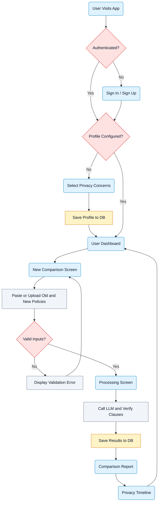
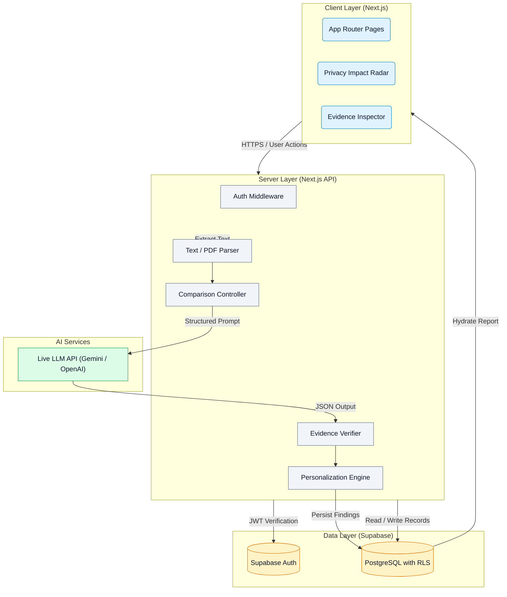
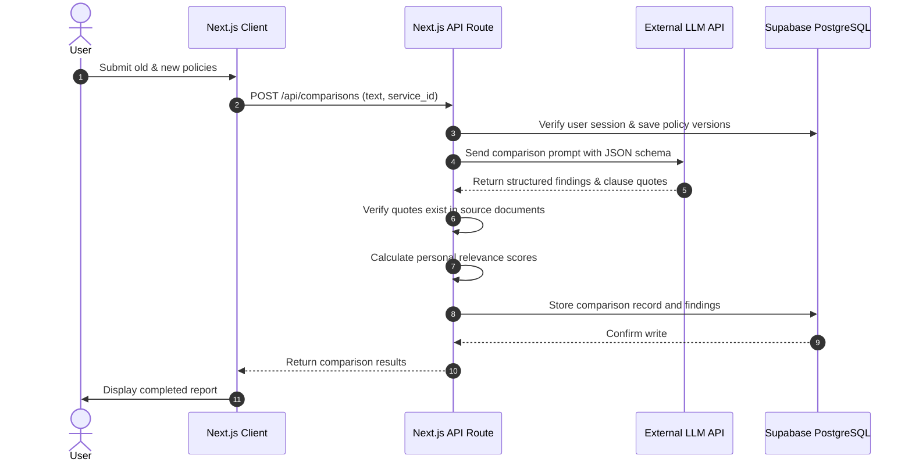
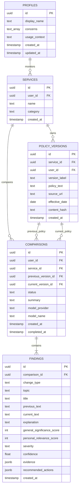

# Privacy Policy Delta Specification

A personalized web application that compares two privacy policy versions, detects semantic changes, and explains their real-world impact based on user-selected privacy preferences.

> **Important:** This application is an informational research tool. Its output represents AI-generated interpretations of user-supplied text and does not constitute legal advice or formal compliance certification.

---

## Table of Contents

- [Overview](#overview)
  - [Target Users](#target-users)
  - [Core Questions Answered](#core-questions-answered)
- [Features](#features)
  - [Feature Matrix](#feature-matrix)
  - [Feature Checklist](#feature-checklist)
  - [Privacy Concerns and Onboarding](#privacy-concerns-and-onboarding)
  - [Scoring and Relevance Logic](#scoring-and-relevance-logic)
- [User Flow](#user-flow)
- [Architecture](#architecture)
  - [System Architecture](#system-architecture)
  - [Execution Flow](#execution-flow)
  - [Technology Stack](#technology-stack)
  - [Security and Safety Rules](#security-and-safety-rules)
- [Data Model](#data-model)
  - [Entity Relationship Diagram](#entity-relationship-diagram)
  - [Database Tables](#database-tables)
  - [AI Output Schema](#ai-output-schema)
- [API Design](#api-design)
  - [Route Endpoints](#route-endpoints)
  - [Analysis Pipeline](#analysis-pipeline)
- [Screens and Interface](#screens-and-interface)
  - [Screen Catalog](#screen-catalog)
  - [Report Layout](#report-layout)
- [Roadmap](#roadmap)
- [Out of Scope](#out-of-scope)
- [Open Questions](#open-questions)

---

## Overview

Privacy Policy Delta prevents users from having to read dense legal documents by comparing old and new privacy policies. It highlights what changed, explains practical risks, and personalizes findings to the user's specific privacy profile while preserving verbatim text evidence.

### Target Users

| User Role | Primary Needs | Key Concerns |
| :--- | :--- | :--- |
| **Privacy-Conscious Individuals** | Understand how personal data, media, and messages are handled | Data collection, targeted advertising, location tracking |
| **Students and Professionals** | Plain-language breakdowns without legal jargon | Clarity, AI training on personal content |
| **Small Business Owners** | Identify risks to business operations and customer records | Third-party data sharing, data retention, breach liability |
| **Parents and Families** | Protect children and household privacy | Minors' data, sensitive information, consent controls |
| **Researchers and Journalists** | Track and verify policy shifts over time | Verifiable clause quotes, historical change records |

### Core Questions Answered

For every substantive policy modification, the application answers four key questions:

1. **What changed?** Shows previous and current text side by side with highlighted additions or deletions.
2. **Why should you care?** Translates legal phrasing into simple language linked to selected user concerns.
3. **How significant is it?** Reports general privacy impact alongside personalized user relevance.
4. **What can you do?** Suggests evidence-supported actions, such as opt-out settings or account controls.

---

## Features

### Feature Matrix

| Feature | Description | Priority |
| :--- | :--- | :--- |
| **User Authentication** | Email sign-up and sign-in with isolated, private user workspaces | MVP (Must) |
| **Privacy Onboarding** | Profile setup to select privacy concerns and primary usage context | MVP (Must) |
| **Dual Policy Input** | Paste raw text or upload text documents for old and new policies | MVP (Must) |
| **Live AI Analysis** | LLM-driven semantic comparison grounded in actual submitted text | MVP (Must) |
| **Impact Radar** | Independent scores for general significance and personal relevance | MVP (Must) |
| **Evidence Inspector** | Exact clause quotations linked directly to findings | MVP (Must) |
| **Comparison History** | Saved reports accessible without re-running AI queries | MVP (Must) |
| **User Dashboard** | Recent comparisons, high-severity findings, and quick-start actions | MVP (Must) |
| **Document File Uploads** | Direct parsing for TXT and text-based PDF files | Should Have |
| **Visual Diff Highlighter** | In-line highlighting of added and removed phrasing | Should Have |
| **Profile Editor** | Modify concerns anytime to dynamically re-rank past reports | Should Have |

### Feature Checklist

- [ ] Email registration, session persistence, and sign-out via Supabase Auth.
- [ ] Onboarding flow saving at least one privacy concern to PostgreSQL.
- [ ] Dual text submission form supporting previous and current policy versions.
- [ ] Live LLM integration returning structured JSON output.
- [ ] Semantic change classifier (added, removed, modified, semantic shift).
- [ ] Scoring engine evaluating general significance (0-100) and personal relevance (0-100).
- [ ] High-risk override keeping critical findings visible regardless of user concerns.
- [ ] Verifiable quote validation matching AI excerpts against source policy text.
- [ ] PostgreSQL persistence for profiles, services, versions, comparisons, and findings.
- [ ] Row Level Security enforcing strict data isolation between accounts.
- [ ] Dashboard displaying recent comparisons and high-severity changes.
- [ ] Responsive UI supporting desktop and mobile screens.
- [ ] Support for TXT and PDF file uploads.
- [ ] Visual diff view for side-by-side clause inspection.

### Privacy Concerns and Onboarding

Users configure their personal threat model by selecting one or more concerns during onboarding:

| Concern Key | Display Name | Core Question Addressed |
| :--- | :--- | :--- |
| `ai_training` | AI Model Training | Can submitted photos, messages, or content train AI models? |
| `third_party_sharing` | Third-Party Sharing | Are personal details sold or transferred to partners and advertisers? |
| `tracking_ads` | Tracking and Ad Targeting | Does the platform track activity across other apps and sites? |
| `data_collection` | Data Collection Scope | What personal, device, or behavioral data is gathered? |
| `retention_deletion` | Data Retention and Deletion | How long is data kept, and can accounts be completely erased? |
| `user_rights` | Control and Consent | Can users access records, revoke consent, or opt out? |
| `security_breaches` | Security and Breach Alerts | What protections and incident notification rules exist? |
| `location_sensitive` | Location and Sensitive Data | Is precise GPS, biometrics, or sensitive data monitored? |

> **Note:** Users can optionally specify a usage context: Personal, Family, Business, or Research.

### Scoring and Relevance Logic

Every finding receives two distinct 0-100 integer scores:

- **General Significance:** Overall severity and impact from a neutral privacy standpoint.
- **Personal Relevance:** Relevance calculated against the user's saved profile.

```text
Personal Relevance = (0.70 * Concern Match) + (0.20 * Context Match) + (0.10 * Topic Strength)
```

> **Important:** Changes rated with high general severity remain visible in report summaries even if they score 0 on personal relevance.

---

## User Flow



---

## Architecture

### System Architecture



### Execution Flow



### Technology Stack

| Layer | Technology | Selection Rationale |
| :--- | :--- | :--- |
| **Framework** | Next.js (App Router) | Unified React frontend with secure server-side Route Handlers |
| **Language** | TypeScript | Strong typing shared between database schemas and API payloads |
| **Styling** | Tailwind CSS + shadcn/ui | Clean SaaS interface, accessible components, and light/dark support |
| **Database** | Supabase (PostgreSQL) | Managed relational database with built-in Row Level Security |
| **Authentication** | Supabase Auth | Cookie-based session management and secure user isolation |
| **AI Provider** | Google Gemini or OpenAI | High context window with native structured JSON schema mode |
| **Hosting** | Vercel | Seamless deployment and environment variable management for Next.js |

### Security and Safety Rules

- **Row Level Security (RLS):** Every PostgreSQL table enforces RLS tied to `auth.uid()`. Cross-user data reads or writes are strictly prevented.
- **Credential Isolation:** Secret keys (`AI_API_KEY`, `SUPABASE_SERVICE_ROLE_KEY`) reside exclusively in server runtime environments and are never bundled into client code.
- **Untrusted Input Handling:** Policy documents are treated as untrusted data. Prompts use system guards to prevent adversarial prompt injection embedded inside uploaded terms.
- **Zero Mock Policy:** All comparison findings originate from a live LLM processing the uploaded text. Hardcoded sample reports are prohibited.

---

## Data Model

### Entity Relationship Diagram



### Database Tables

| Table Name | Description | Key Columns | Security Rules |
| :--- | :--- | :--- | :--- |
| `profiles` | User preferences and threat settings | `id` (matches auth.users), `concerns`, `usage_context` | RLS: owner read/update only |
| `services` | Companies or applications being tracked | `id`, `user_id`, `name`, `category` | RLS: owner read/write/delete |
| `policy_versions` | Raw extracted policy text snapshots | `id`, `service_id`, `version_label`, `policy_text`, `content_hash` | RLS: owner access only |
| `comparisons` | Comparison run metadata and state | `id`, `user_id`, `service_id`, `status`, `summary` | RLS: owner access only |
| `findings` | Atomic semantic differences detected by AI | `id`, `comparison_id`, `topic`, `scores`, `evidence`, `actions` | RLS: owner access only |

<details>
<summary>View AI Output Schema (JSON)</summary>

```json
{
  "$schema": "http://json-schema.org/draft-07/schema#",
  "type": "object",
  "required": ["summary", "findings"],
  "properties": {
    "summary": { "type": "string" },
    "findings": {
      "type": "array",
      "items": {
        "type": "object",
        "required": [
          "title",
          "change_type",
          "topic",
          "explanation",
          "general_significance_score",
          "severity",
          "confidence",
          "evidence"
        ],
        "properties": {
          "title": { "type": "string" },
          "change_type": { "enum": ["added", "removed", "modified", "semantic"] },
          "topic": { "type": "string" },
          "previous_text": { "type": ["string", "null"] },
          "current_text": { "type": ["string", "null"] },
          "explanation": { "type": "string" },
          "general_significance_score": { "type": "integer", "minimum": 0, "maximum": 100 },
          "severity": { "enum": ["low", "medium", "high", "critical"] },
          "confidence": { "type": "number", "minimum": 0, "maximum": 1 },
          "evidence": {
            "type": "object",
            "properties": {
              "previous_clause_reference": { "type": "string" },
              "current_clause_reference": { "type": "string" }
            }
          },
          "recommended_actions": {
            "type": "array",
            "items": { "type": "string" }
          }
        }
      }
    }
  }
}
```

</details>

---

## API Design

### Route Endpoints

| Method | Endpoint | Request Payload | Response / Purpose | Auth |
| :--- | :--- | :--- | :--- | :--- |
| `GET` | `/api/profile` | Empty | User profile and selected concerns | Session |
| `PATCH` | `/api/profile` | `{ concerns, usage_context }` | Updated profile record | Session |
| `GET` | `/api/services` | Empty | List of monitored services | Session |
| `POST` | `/api/services` | `{ name, category }` | Created service record | Session |
| `POST` | `/api/comparisons` | `{ service_id, prev_text, curr_text }` | Initiates analysis; returns comparison record | Session |
| `GET` | `/api/comparisons` | `?service_id=<id>` | History of comparison runs | Session |
| `GET` | `/api/comparisons/:id` | Empty | Full report with ranked findings | Session |
| `GET` | `/api/comparisons/:id/status`| Empty | Processing state (`processing`, `ready`, `error`) | Session |
| `DELETE` | `/api/comparisons/:id` | Empty | Deletes comparison and child findings | Session |

### Analysis Pipeline

1. **Input Validation:** Reject empty inputs, unreadable files, or policies exceeding context length.
2. **Text Normalization:** Standardize whitespace and line endings without modifying clause phrasing.
3. **LLM Execution:** Send normalized versions to the AI provider with structured JSON schema constraints.
4. **Evidence Verification:** Check that extracted clause quotations actually exist in submitted text.
5. **Relevance Calculation:** Apply user preference weights to score personal relevance (0-100).
6. **Data Persistence:** Atomically write comparison metadata and findings to PostgreSQL.
7. **Report Hydration:** Return populated records to the frontend; future views load from database.

---

## Screens and Interface

### Screen Catalog

| Screen Name | Route | Purpose | Key UI Elements |
| :--- | :--- | :--- | :--- |
| **Landing Page** | `/` | Explain value proposition and onboarding hook | Value overview, CTA buttons, feature highlights |
| **Authentication** | `/login`, `/signup` | User sign-in and account registration | Email/password form, OAuth options, error alerts |
| **Onboarding** | `/onboarding` | Capture user privacy priorities | Concern checkboxes, use-case selector, save button |
| **Dashboard** | `/dashboard` | User command center | "New Compare" CTA, recent runs, high-risk alert tiles |
| **New Comparison**| `/compare` | Input old and new policies | Side-by-side text boxes, file drag-and-drop, service picker |
| **Processing** | `/compare/loading` | Show progress during live AI execution | Animated progress bar, step status indicators |
| **Comparison Report**| `/reports/:id` | Primary intelligence results | Radar summary, severity filter, side-by-side diff viewer |
| **Timeline** | `/history` | Historical audit log of policy changes | Chronological change feed, service filter, link to reports |
| **Profile Settings** | `/settings/profile` | Update privacy concerns | Reconfigurable topic toggles, re-rank trigger |

### Report Layout

The comparison report renders information in a structured, hierarchical sequence:

1. **Header:** Service name, version dates, and total finding counts.
2. **Executive Summary:** High-level narrative of the changes and overall direction.
3. **Score Overview:** Side-by-side indicators for General Significance vs. Personal Relevance.
4. **Priority Findings:** Top-ranked findings directly matching the user's threat model.
5. **Evidence Inspector:** Expandable cards displaying previous wording, current wording, and diff markers.
6. **Action Checklist:** Practical next steps (opt-out forms, permission changes, contact links).
7. **Full Findings List:** Filterable registry of all detected changes sorted by category and severity.

---

## Roadmap

| Phase | Milestone | Deliverables | Status |
| :---: | :--- | :--- | :---: |
| **1** | Foundation | Next.js setup, Supabase authentication, database migrations, RLS policies | Complete |
| **2** | Profile Setup | Onboarding UI, concern configuration, profile persistence | In Progress |
| **3** | Policy Input | Comparison form, text validation, TXT file parsing | Planned |
| **4** | AI Engine | LLM API integration, JSON output schema, quote verification | Planned |
| **5** | Scoring and Reports | Dual-score ranking, Impact Radar, side-by-side evidence view | Planned |
| **6** | History and Polish | Dashboard, timeline view, mobile responsiveness, demo preparation | Planned |

---

## Out of Scope

The following items are explicitly excluded from the current build:

- Automated web crawlers or scrapers to continuously pull live policy updates.
- Browser extensions for on-the-fly webpage policy scanning.
- Automated compliance certifications or formal legal guarantees.
- Email or SMS push notification services.
- Multi-user collaborative team or organization accounts.
- Exporting comparison reports to branded PDF files.

---

## Open Questions

- **Large Policy Chunking:** How should documents that exceed the model's single-prompt context window be chunked without losing semantic cross-references between sections?
- **Serverless Timeout Limits:** Long-running LLM comparisons may exceed standard 10-second serverless execution limits on Vercel Hobby tiers. Should long jobs use Supabase Edge Functions or background queue polling?
- **PDF Extraction Engine:** Should PDF parsing occur client-side in the browser to reduce server payload size, or server-side via `pdf-parse` for consistent text normalization?
- **Diff Granularity:** Will users benefit more from strict character-level diff highlighting or sentence-level semantic block comparisons?
